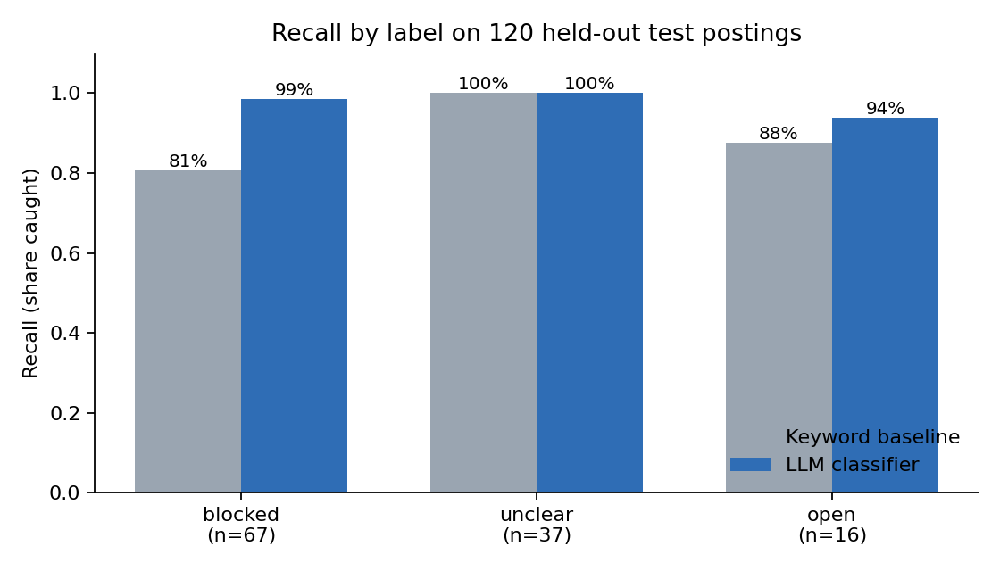

# Do They Sponsor? Classifying Work-Authorization Restrictions in Job Postings

International students on F-1 OPT lose hours applying to postings that quietly rule them out: "U.S. citizenship required," "active Secret clearance," "without the need for current or future sponsorship." These sentences are often buried near the end of a long description and phrased dozens of different ways.

This project compares two ways to detect them automatically across 150 real U.S. entry-level analyst postings:

1. **Keyword baseline**: hand-written regular-expression rules
2. **LLM classifier**: a prompt that returns a label **plus the exact sentence it relied on**, so every prediction can be checked

Both are scored against labels I reviewed by hand.

**Tools:** Python (pandas, regex, matplotlib), Anthropic Claude API (`claude-haiku-5-5`)

## Key Results

On 120 held-out test postings that were never used while building either method:

| | Keyword baseline | LLM classifier |
|---|---|---|
| **Overall accuracy** | 87.5% (105/120) | **98.3% (118/120)** |
| Blocked postings caught (recall) | 81% (54/67) | **99% (66/67)** |
| Open postings caught (recall) | 88% (14/16) | 94% (15/16) |
| False "blocked" or "open" calls | 0 | 0 |
| Evidence quotes found verbatim in posting | n/a | **83 / 83** |



- **Keyword rules are precise but brittle.** They never mislabeled a posting; every one of their 15 errors was a real restriction (or a real welcome) that they failed to recognize and marked "unclear."
- **The LLM closed most of that gap without inventing evidence.** Every quote it returned appears word for word in the posting.
- **For a job seeker, missing a restriction is the costly error** (you apply and are auto-rejected), so recall on "blocked" is the number that matters most. It rose from 81% to 99%.

## Labels

Each posting gets one label from the viewpoint of an F-1 OPT candidate who will need sponsorship later. Full rules are in [`LABELING_GUIDE.md`](LABELING_GUIDE.md).

| Label | Meaning | Count (of 150) |
|---|---|---|
| `blocked` | Requires citizenship/permanent residency, a security clearance, U.S.-person status, or states no sponsorship now or in the future | 84 |
| `unclear` | No statement, or only "must be authorized to work in the U.S." | 46 |
| `open` | Says sponsorship is available, or OPT/CPT/international students are eligible | 20 |

## Method

1. **Collection.** 150 postings for entry-level data, business, pricing, and research analyst roles, gathered from company career sites and job boards. The search query used for each posting is recorded in `data/postings_index.csv`.
2. **Labeling.** An AI tool drafted a label and evidence quote for each posting. I then read all 150 against the posting text and corrected 2 labels (99% agreement with the drafts). Flagged rows were checked most closely.
3. **Split.** A stratified 30-posting development set for building both methods, and a 120-posting test set used only once, for the final scores.
4. **Keyword baseline** ([`src/baseline.py`](src/baseline.py)). Rules checked in priority order: explicit OPT eligibility → open; any blocking phrase → blocked; any welcoming phrase → open; otherwise unclear. Tuned on the development set only (29/30 correct).
5. **LLM classifier** ([`src/llm_classifier.py`](src/llm_classifier.py)). One prompt per posting with the label definitions and edge-case rules (for example, an equal-opportunity statement mentioning "citizenship status" is not a restriction). Returns JSON: `{label, evidence_quote}`. The code then checks whether the quote actually appears in the posting. Responses are cached so results are reproducible. About 2,000 input and 130 output tokens per posting.
6. **Evaluation** ([`src/evaluate.py`](src/evaluate.py)). Per-label precision, recall, F1, and confusion matrix, rather than overall accuracy alone, since a model that always answered "blocked" would already be right 56% of the time.

## Error Analysis

All 17 test-set errors are listed in [`results/error_analysis.csv`](results/error_analysis.csv).

| Error type | Method | Count | Example |
|---|---|---|---|
| Clearance named without the word "security" | Keyword | 4 | "Active Secret clearance" |
| Too many words between "not" and "sponsor" | Keyword | 4 | "We do not offer any type of employment-based immigration sponsorship" |
| Unanticipated phrasing | Keyword | 3 | "Sponsorship will not be considered for this specific role" |
| Requirement written as a qualification, without "required" or "must" | Keyword | 2 | "U.S. Citizen with a DoD Top Secret clearance" |
| Welcoming signal in unlisted wording | Keyword | 2 | "While Etsy supports visa sponsorship" |
| Ambiguous, conditional posting | LLM | 1 | "U.S. Citizenship is required for all positions with a government clearance and certain other restricted positions," in a posting that also says "Clearance required for start: No" |
| Too cautious on a hedged yes | LLM | 1 | "Limited immigration sponsorship may be available" (labeled open; LLM said unclear) |

Eight of the fifteen keyword misses trace back to just two narrow assumptions in the rules. Each is easy to fix once seen, but they only became visible on postings the rules had never been tuned on. Real postings phrase the same restriction in too many ways for a fixed list to keep up.

## Limitations

- **Small sample.** 150 postings, 16 `open` in the test set; one error moves open recall by 6 points.
- **Single labeler.** Labels reflect my reading of the guide; two LLM "errors" are on postings where reasonable readers could disagree.
- **Inconsistent on hedged wording.** The LLM called "sponsorship may be considered" open but "sponsorship may be available" unclear.
- **Easy cases dominate.** Most blocked postings contain an obvious phrase; a harder set (implicit or indirect wording) would separate the methods further.
- **Raw text not published.** Posting text belongs to employers, so `data/postings/` is excluded; the index keeps each posting's URL, metadata, label, and evidence quote.

## Repository Structure

```
job-posting-auth-classifier/
├── data/
│   ├── postings_index.csv     # metadata, URL, AI draft label, evidence quote per posting
│   ├── label_review.csv       # review sheet used for hand labeling
│   ├── labels_final.csv       # final hand labels (ground truth)
│   └── split.csv              # dev / test assignment
├── src/
│   ├── baseline.py            # keyword rules
│   ├── llm_classifier.py      # Claude API classifier with evidence quotes
│   ├── evaluate.py            # precision / recall / F1 / confusion matrix
│   └── ...                    # data building, cleaning, review-sheet and split scripts
├── results/                   # predictions, cached LLM responses, error analysis
├── figures/
├── LABELING_GUIDE.md
└── COLLECTION_GUIDE.md
```

## How to Run

```
pip install -r requirements.txt
echo "ANTHROPIC_API_KEY=your-key" > .env        # never commit this file
cd src
python3 baseline.py test
python3 llm_classifier.py test                    # uses cached responses in results/llm_raw if present
python3 evaluate.py ../results/baseline_preds_test.csv
python3 evaluate.py ../results/llm_preds_test.csv
```

Running from scratch requires your own collection of posting text in `data/postings/`, since it is not distributed here.

## Author

**Edison Gao** · B.S. Applied Mathematics, UCLA (Dec 2026)
[LinkedIn](https://www.linkedin.com/in/edison-gao-64463937a) · [GitHub](https://github.com/edisongao413-cloud)

Built with Claude (Anthropic) as a coding collaborator: I collected and labeled the data, reviewed the code, and led the error analysis; Claude helped write the code.
